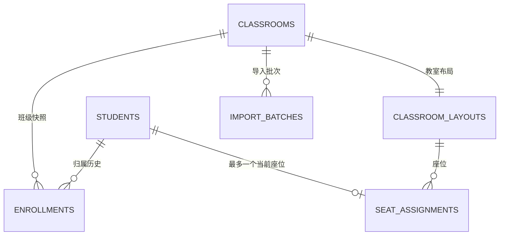

> 2026-11-19最新调整：图谱已迁入独立SQLite及/chemistry-graph空间，五业务入口；旧50条上海映射建议仅作历史归档，不再用于新图谱导航。以下早期说明用于历史追溯，当前架构及操作以phase-03-independent-chemistry-graph-report.md为准。

# 技术架构：第三阶段

当前版本0.3.0。第一、二阶段已获项目所有者亲自验收。本阶段仅新增教材目录驱动的知识点题库；试卷、考试、成绩和AI业务仍未授权。

## 分层与通信

React/TypeScript + Vite + Tailwind、shadcn/ui 本地组件、Lucide、React Router。保留第一阶段浅色/深色、四项业务导航和紧凑教室布局。

- src/pages/Classes.tsx：教室、班级切换、名册、待保存的座位安排。
- src/features/classes：班级和学生表单、全局学生目录、Excel 预览与操作记录。
- src/pages/StudentDetail.tsx：学生档案、归属历史、编辑/转班/归档入口及未来教学记录占位。
- api.ts：同源 JSON/FormData 请求及错误处理。真实数据全部来自后端；只有未保存的排座草稿留在页面状态。

浏览器 `127.0.0.1:5188 /api` → Vite 代理 → FastAPI `127.0.0.1:8087` → 独立 SQLite。所有服务仅绑定本机，不使用 8086。

后端 API、Pydantic 输入、业务服务与 SQLAlchemy 模型分开。Storage RLock 同时覆盖业务事务、健康、备份和恢复，防止恢复时仍在写业务。SQLite 连接启用外键、busy_timeout 和显式 BEGIN IMMEDIATE；业务及审计在同一事务提交。额外 OS 文件锁防止两个后端使用同一库。

## 第一、二阶段保留的数据模型

以下既有九张表保持，第三阶段不重建：

| 表 | 用途及核心约束 |
| --- | --- |
| classrooms | UUID 主键、名称、学年、年级、编号、归档标记、创建/更新时间；名称不唯一 |
| students | UUID 永久主键、姓名、可选学号/性别/入学年、备注、状态；非空学号全实例唯一 |
| enrollments | 学生、班级外键，入班时班级/学年/年级/编号快照，开始/结束时间和原因；部分唯一索引保证学生仅一个未结束归属 |
| classroom_layouts | 每班一个布局，行、列（1–12）和并发版本 |
| seat_assignments | 班级+行+列复合主键；student_id 唯一；学生及布局外键 |
| audit_logs | 时间、教师来源、动作、实体 ID、变更前后 JSON，记录关键操作 |
| import_batches | 目标班级、文件 SHA256、结果与导入时间；班级+文件哈希唯一，重复文件幂等 |

同名不合并；姓名、学号或班级均不作为永久 ID。学号唯一是第一版校验规则，可不填写，不替代永久 ID。没有身份证、手机号、地址等字段。

## 业务一致性与历史

转班在一个事务内：校验目标未归档 → 记录旧状态 → 删除原座位并递增旧布局版本 → 结束旧归属 → 新建归属快照 → 写入学生操作记录。永久 ID 不变。

学生归档：释放座位、结束当前归属、状态改为 archived，保留档案及所有历史。班级归档保留学生当前归属和座位，只读展示，可将学生转出，不能向归档班级新增/导入/安排座位。本阶段均不提供删除或取消归档。

改班级学年、年级或编号时，结束当前归属段并为在班学生建立新段，保留旧快照，座位不变；仅改名保留原入班快照，并在班级操作记录中记录名称变化。

保存座位提交完整布局和 expected_version；版本不匹配 409，不覆盖已有安排。先验证学生属于当前班、状态有效、座标合法、不重复，再事务内替换座位并递增版本，记录班级布局和每名受影响学生的变化。数据库复合主键、学生唯一键以及归属/范围触发器共同约束。交换可通过全量布局事务完成，不出现两个学生争用同一座位的中间提交。

缩小布局不会自动截断占座：必须先在草稿中清空范围外位置，非法保存原子拒绝。前端有拖拽和点击选择两种安排方式，刷新前须显式保存。

## Excel 导入

openpyxl 生成空白五列模板并读取 .xlsx；defusedxml 保护 XML 解析，python-multipart 处理上传。不保存上传原文件。

读取前检查扩展名、5MB 压缩大小、30MB 解压总大小及 ZIP 项数量，拒绝宏/外部链接。扫描行列有限制，最多 1000 个数据行，不接受公式及模板外数据列。逐行通过同一 StudentInput 校验；学号必须文本，避免前导零丢失。

预览不写库；提交重新检查当前数据库和重复记录，不信任预览缓存。错误行使整批拒绝；重复可拒绝或跳过，后者只新增其余有效行，不更新已有学生。批次、所有学生、归属及操作记录同事务提交。相同二进制文件同班级重复提交直接返回原批次；不按姓名推断身份，无法以姓名可靠去重的无学号修改版文件必须人工核对。

## 安全迁移、备份与恢复

数据与备份默认位于用户 Library/Application Support/TeachingAssistantWorkbench 下两个独立目录，可用环境变量覆盖。非空无归属标识目录、跨实例库、目录符号链接、未知版本拒绝操作，不访问 SmartKBS。

- 0001 保留不变；0002 只新增本阶段表、索引与触发器，无清库、DROP 或降级路径。
- 既有 0001 先验证项目/实例/完整性，生成并校验 before-migrate 副本，再通过 Alembic 增量升级；显式事务保护 DDL。
- 一致备份采用 sqlite3 backup，检查 integrity_check、foreign_key_check、项目、实例和版本。只接受本实例受控文件名，拒绝路径穿越、符号链接或损坏文件。
- 恢复须确认文字；先备份当前库，再在临时文件验证并升级旧版备份，校验后 dispose 连接、原子替换。源备份不修改。
- storage-events.jsonl 在数据库外追加迁移/恢复事件及副本关联，恢复不回滚该日志；恢复后的业务审计来自选中时点，较新数据和审计仍在恢复前副本。

备份仅本机，不提供自动轮转、加密、跨实例导入、磁盘级灾难恢复。恢复前请结束其他页面未保存编辑，恢复后刷新所有页面。

写接口要求 X-Workbench-Request: 1，并检查来源和 Host；无宽松 CORS。不记录请求体或姓名查询参数，错误使用中文 JSON 信封；审计仅在本地受控库中。单用户本地服务没有多教师账号鉴权，不可暴露网络。

## 后续扩展边界

未来题目与知识点为多对多，试卷题目需版本快照，考试与逐题记录关联 students.id 和有效考试参与关系，不依赖当前班级名称或学号。分析必须基于真实考试记录。上述仅为设计，不建立题库、试卷、考试或 AI 表。

参考：[SQLAlchemy SQLite 官方说明](https://docs.sqlalchemy.org/en/20/dialects/sqlite.html)、[openpyxl 读取及生成文档](https://openpyxl.readthedocs.io/en/stable/tutorial.html)、[Vite 运行要求](https://vite.dev/guide/)。依赖由锁文件固定；稳定版本不代表安全审计必然通过，告警见阶段报告。

## 第三阶段新增架构

- 前端 pages/Questions、CatalogManager、KnowledgeManager、QuestionEditor、QuestionDetail；features/library负责树、关联、导入与Tiptap编辑。富文本按需加载，KaTeX+mhchem本地渲染，使用白名单结构化JSON和React安全节点展示。
- 后端 core/library_models、library_schemas 与 services/library、library_import、rich_content、question_assets；api/library统一暴露元数据、检索、版本审核与上传。业务与既有事务/审计/存储锁复用。
- 0003冻结新增十五张表，详细关系及约束见 docs/phase-03-data-model.md。没有题库初始样例或自动出版社目录。
- knowledge_points身份独立；curriculum_mappings和question_curriculum_nodes支持多版本/多章节复用。章节范围先求ID集合，分页和统计去重。
- question_revisions不可变快照为后续试卷保留ID+版本边界；正式试卷业务未创建。编辑及新增章节引用回到草稿，导入不绕过审核。
- 备份扩展为SQLite和同名.assets目录，包含清单和SHA256校验；旧版无附件备份兼容升级。恢复前留下完整副本，先物化不可变附件，再原子发布数据库。

参考：[Tiptap扩展机制](https://tiptap.dev/docs/editor/core-concepts/extensions)、[KaTeX安全选项](https://katex.org/docs/security)。公式以trust=false、展开上限限制，无外部图片或任意HTML执行。

## 第三阶段补充02：可追溯教材目录种子

上海五四化学目录采用数据初始化脚本，不改0003数据库结构。主题/专题/课题适配既有chapter/section/lesson通用树；跨学科实践和复习为专题子节点，附录为根节点。原始语义、页码、核实状态和来源由种子JSON与目录说明保留。

textbook_seed服务复用Storage独占锁和完整备份，通过单事务新增目录及审计，用UUID5、导入批次和数据SHA256保证幂等；拒绝覆盖教师修改。八年级采用第三方版权页转录所示2024年8月第1版，九年级采用2025年8月第1版，不把尚未核实的2026秋标签当作版本身份。详见phase-03-textbook-import-report.md及data-seeds/textbooks/shanghai-junior-chemistry。

## 第三阶段补充03：外部初中化学知识图谱

0004增量迁移仅新增taxonomy_sources、taxonomy_items、taxonomy_mappings，并给knowledge_points增加review_status（既有人工知识点默认approved）。正式导入前通过原有Storage自动生成before-migrate数据库及附件副本。原0001–0003迁移冻结；旧备份恢复可安全升级至0004。

来源固定为cn-math-taxonomy的aa2c22058222d0df404f1819e2fbdb97a62049ea，只提取cnk_j。来源记录保存仓库、commit、许可证、署名、原ID/原始payload与本地UUID，支持point/question/dependency三种记录。映射建议保存课题ID、依据、置信程度和审核状态。主库知识点明确pending；题目以pending入库并有版本和导入审核记录。所有既有数据不覆盖、不按同名自动合并。

辅助先修记录point_id为后续知识点、prerequisite_id为前置知识点，图谱箭头前置→后续；教师确认后写入既有核心关系source=后续,target=前置（即source依赖target），数据库仍检查循环。hard/soft和理由始终保存在来源记录。章节建议确认前不写正式curriculum_mappings；手动主库关联在图谱中同步反映。

48份SVG经基础绘图白名单及隔离无网络/无脚本浏览器转PNG，导入时再次Pillow校验/重编码并保存到独立业务assets目录。源SVG仅作为JSON中的文字记录，verify不执行。文件与整个来源批次的数据库写入失败会回滚并清理本次新附件。来源JSON、图片SHA256和导入哈希保障固定commit幂等；不自动联网更新来源。

题库新增二级/graph视图；四项一级导航不变。当前仅作知识关系和来源审核，不执行学生诊断或AI分析。中文交付和来源/映射限制见phase-03-chem-taxonomy-integration.md。

## 第三阶段补充03最新调整：独立化学知识图谱

独立路由/chemistry-graph/*，旧/questions/graph重定向。React Flow12.11.2二维图支持拖拽、缩放、平移、局部/全局和搜索定位，右侧抽屉显示详情。审核和备份放独立数据管理，一级导航新增第五入口。

主库0005增量增加data_space及graph_transfer_receipts，不删除旧记录。来源实体置于chemgraph_legacy历史命名空间；主库检索、统计、去重、关联和编辑均排除来源实体。六主题65节点及教师内容保持。

ChemistryStore独立数据文件为业务数据目录/chemistry-graph/chemistry.sqlite3，图片为同级assets。单独Alembic cg0001建立points/questions/edges/sources/archive/history/imports/view_state/sessions/audit和question_assets。独立APP标识、实例、文件锁、外键、环检测和事务保护。独立备份目录为主备份目录/chemistry-graph；数据库及图片配套校验，恢复前先备份且不覆盖主库。系统设置提供独立范围入口。

离线迁移：人工变更/关联扫描→备份→复制当前内容及原ID、原始字段、版本/审核/审计及50条旧建议归档→逐表哈希及图片校验→旧库逻辑隔离。遇冲突停止自动发布，不清除关联。独立副本已提交但主库未发布时可核对后重试，不覆盖独立编辑。

教师练习重新实现上游规则的保守子集：目标知识点两次作答，标准题后依作答选拓展/基础题，两次错误后最多回溯两条先修（强前置优先），总计最多20题；不推断未测点掌握，不写学生画像。原题按字母/数值参考答案比较，编辑后的题用教师自评，练习保存题目版本快照。未执行上游engine.js或verify。

## 2026-11-19：正式教材内容初始化（当前有效增量）

独立图谱暂停后续开发，数据和路由保持；当前仅完善原题库，主库升级0006，独立库仍cg0001。六主题十专题及65个目录节点永久ID保持。

新增`textbook_content`服务负责幂等种子、候选关联和教师批量审核；`textbook_validation`以受控数值/化学式检查教学草案。`knowledge_point_profiles`保存教学要求、掌握标准、难度范围、来源及版本；`content_candidates`分别指向知识点或题目和已有目录节点；`content_review_batches`保存预览快照；`content_reviews`保存处理前后及备注。所有新增业务数据仅在主库。

章节查询将正式关系与有效候选关系取并集，按题目UUID去重并后端分页。候选内容展示待审核，不自动进入已审核统计。主题/专题默认包含下级；可显式切换仅当前节点。点开知识点用抽屉查看，题目列表可展开答案解析。集中审核是`/questions/review`。

审核预览存储项目内容哈希、版本及本次范围内候选关系ID。提交时重新校验，任何过期、重复提交或非法状态导致事务回滚。批准时只确认本批范围内关联；题目批准要求对应知识点已经或同批批准。退回题目为草稿，知识点为rejected；编辑种子知识点/题目会重新进入待审核或草稿。原题目版本和审核记录机制继续使用。当前不实现考试可用资源选择器或试卷业务。

迁移前由Storage生成数据库和主附件快照，导入前再备份；独立图谱数据不迁移、不同步，恢复范围仍清楚分开。所有原始行、目录和独立图谱文件通过哈希比对保护。生产库不执行试验性的恢复或审批，自测使用独立模拟实例。

## ScienceLab 3D独立化学互动课件

新增/chemistry-lab首页及/chemistry-lab/:id，作为第六业务入口。固定上游commit的10个化学scene直接移植到features/chemistry-lab，无Next.js子服务、iframe或额外端口。React Three Fiber/Three.js运行真实场景，Drei提供几何辅助、相机、SDF文字及本地光照；按需加载不会让普通题库页面初始化WebGL。

LabClock提供可冻结的虚拟时间与速度，场景参数来自中文资源配置，重置恢复默认值并重建场景和相机。LabAnnotation将来源Html注释锚定为本地三维文字，避免React19切换时的独立DOM根卸载警告。LabPlayer通过Portal隔离沉浸层，背景工作台暂时inert，返回时恢复。首页遵循工作台主题，沉浸场景保持夜色画布。

locales/集中管理中文、术语、科学目标与模型边界；脚本执行AST漏译检查及字体覆盖检查。本地字体含中文、上下标数学符号和罕见元素字，无CDN资源；新文本须经覆盖检查。

该空间没有后端写接口、数据库或新增迁移，主库0006与图谱cg0001保持。收藏是浏览器本地键，与教学业务隔离，提供经过已知ID校验的JSON导入/导出；主库备份不含收藏，界面明示单独导出。

课件只展示上海主题建议，不建立知识点或题库关系，不保存学生实验成绩，不启用AI。来源和更改记录见third-party/sciencelab3d；科学修正与未覆盖范围在三份课件报告中列出。
