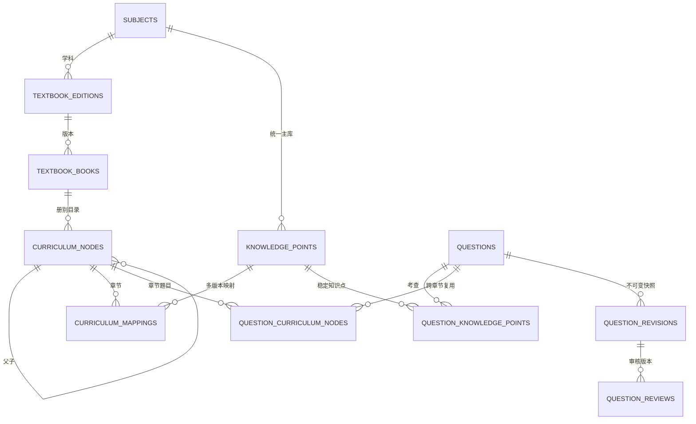

# 第三阶段数据模型：教材目录驱动的知识点题库

此文件描述已经实现的 0003 增量迁移。第一、二阶段九张表全部保留；没有试卷、考试、成绩或 AI 正式业务表。

## 新增十五张表

| 表 | 身份、关系与约束 |
| --- | --- |
| subjects | 学科永久 UUID；编码唯一，名称与启用状态 |
| textbook_editions | 教材版本 UUID，所属学科外键；同学科版本名唯一 |
| textbook_books | 册别 UUID，版本外键；版本内年级+册别唯一 |
| curriculum_nodes | 章/节/课时节点 UUID，册别外键，自关联父节点、排序、说明、启用状态；索引按册别/父级/位置/ID |
| knowledge_points | 独立知识点 UUID，学科、名称、编码、说明、父知识点；学科内编码唯一 |
| knowledge_point_relations | 前置/相关关系，源与目标外键；关系三元组唯一，禁止自身引用 |
| curriculum_mappings | 目录节点与知识点多对多；复合主键防止同一映射重复 |
| questions | 永久题目 UUID，学科、年级、八种题型、结构化题干/答案/解析、难度、来源、状态、版本、时间、标准化文本与指纹 |
| question_knowledge_points | 题目+知识点复合主键，主要知识点、可选权重及涉及小问；每题最多一个主要知识点 |
| question_curriculum_nodes | 题目+目录复合主键，跨章节复用同一题目，不复制实体 |
| question_assets | 图片 UUID、本机存储名、类型、大小、SHA256、像素、原名与时间 |
| question_asset_links | 当前题目与图片外键关联，复合主键防重复；历史图片保持在附件表中 |
| question_revisions | 题目 ID+版本唯一，不可变的完整内容/关联快照、修改原因与时间 |
| question_reviews | 题目/版本外键，提交/通过/退回/归档、前后状态、备注与时间 |
| library_import_batches | 题目或目录导入批次，范围 ID、文件 SHA256、逐行预览和结果；种类+范围+哈希唯一 |

学生 import_batches 保持原状，新题库导入批次采用 library_import_batches，避免改变已验收学生导入的数据规则。

## 目录、知识点与题目相互独立

目录改名、排序或同册别内调整父级，不更改知识点/题目 ID，不重写关联。目录层级不强制完整章→节→课时，可以直接章→课时或从课时起步。目录父子关系必须同册别，知识点父级必须同学科；服务校验和 SQLite 递归触发器拒绝循环。

知识点可映射同学科不同教材版本的多个章节/课时；题目可关联多个知识点及多个教材节点。所有关系使用永久 ID，不使用名称或章节路径作身份。主知识点、权重、小问编码、满分与评分依据是后续归因结构，不在本阶段计算成绩或掌握度。

前置关系方向是“源知识点需要先掌握目标知识点”；拒绝循环。相关关系按 ID 规范化保存，对教师显示为双向。没有物理删除入口，停用保留已有引用；不能新增指向停用目录分支的关联，已有历史引用保留。

## 范围、分页与统计

题目查询按学科、年级、题型、难度、知识点、审核状态、题干文本过滤。章节范围分为当前节点与全部后代节点；先计算题目 ID 集合，再分页和统计，因此同题关联父、子及多个课时只算一次。

题目列表服务端分页，默认20，支持10/20/50，接口上限100。列表不加载历史快照；详情才查询版本及审核记录。知识主库及目录是较小的元数据集合，由前端用于树形导航、选择与搜索。

统计由 SQLite/程序计算，不调用 AI，随当前范围与筛选变化；全部状态包含归档。覆盖分母为当前学科启用知识点，章节视图则为范围内映射的启用知识点；分子为这些知识点中被当前题目集合覆盖的数量。

## 审核及版本

手工录入与导入均先保存草稿。草稿填写标准答案后可提交待审核，教师明确通过后成为已审核；退回必须填原因。归档题目只读。编辑或新增章节引用使题目回到草稿，旧版本及旧审核保留。

每次内容或状态变化均创建递增版本快照，写入审核/基础审计；expected_version 拒绝覆盖过期编辑。未来试卷必须引用 question_id + version 或复制该不可变快照，不能直接读取题库最新内容。本阶段未实现组卷。

## 内容与图片

Tiptap 编辑结构化 JSON，服务端只接受白名单节点、标记和属性，拒绝原始 HTML、事件属性、任意链接及外部图片。显示使用 React 转义和安全节点渲染；只有 KaTeX 生成的公式 HTML 被渲染，trust=false 且限制展开。mhchem 在本机支持反应箭头、电荷与上下标，无 CDN。

图片只接受 PNG/JPEG/WebP，5MB 上传、2000万像素上限；Pillow 校验并重编码，去除无关原始元数据。UUID 文件名、格式/大小/哈希校验、防符号链接和路径穿越；图片在 data/assets，不依赖浏览器缓存。无删除图片入口，保护历史版本；取消编辑留下的已上传图片当前也保留。

## 备份与恢复附件

0003 备份是“受控命名.sqlite3 + 同名.sqlite3.assets/”一对。附件目录含清单和独立图片副本；数据库记录与清单、SHA256、大小逐一校验。两者必须成对保管。

恢复先留当前完整副本，校验源、复制缺少的不可变图片，再原子发布数据库；已有图片哈希冲突时拒绝覆盖未知内容。恢复不删除较新图片，便于恢复前副本与旧版本追溯。0001/0002 无附件的旧备份仍可在临时文件内升级后恢复，源文件不变。

所有业务写入与审计使用同一事务，并与备份/恢复共用存储锁；图片文件在注册事务失败时仅清理本次新建文件，不删除碰撞文件。当前数据库或在册附件损坏、无法形成完整恢复前副本时安全拒绝，不提供灾难恢复向导。

## 0006：教材原创内容与集中审核

在已有0005主库上增量新增四表，不重建旧表：

| 表 | 用途 |
| --- | --- |
| knowledge_point_profiles | point_id外键/主键；教学要求、掌握标准JSON、1—5难度区间、来源、乐观版本 |
| content_candidates | 稳定ID；point_id和question_id恰好一个；node_id外键；同实体/节点唯一；候选依据、建议置信值、pending/approved/rejected |
| content_review_batches | 预览项目、版本/内容哈希、操作、范围和备注JSON；一次性consumed标记 |
| content_reviews | 知识点或题目、操作、备注、批次ID、前后完整快照和时间 |

正式`curriculum_mappings`及`question_curriculum_nodes`只在教师明确确认时新增。原题目—知识点关系在导入时建立；课题候选关系使待审核内容立即可见。知识点UUID与题目UUID不随章节复用变化；专题复习及附录不重复创建实体。候选置信值只是人工编制的建议强度，不是权威验证或概率。

种子版本及文件哈希写入`library_import_batches`，同版本哈希不一致拒绝覆盖；事务失败回滚。本次导入64知识点、192题目、536候选关系，均无自动批准。独立化学库及历史chemgraph_legacy不属于本次种子范围。
